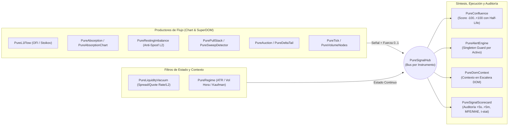

# ⚡ Pure NT8 Suite — Order Flow, Market Microstructure (L1/L2) & Auction Ecosystem

[](https://ninjatrader.com/)
[](#)
[](#%EF%B8%8F-arquitectura-del-ecosistema)
[](LICENSE)
[](#)

> [!IMPORTANT]
> **🔒 Nota sobre Propiedad Intelectual y Muestras de Código (*Code Samples*)**
>
> **Pure NT8 Suite** es un ***side-project* personal e independiente de ingeniería de microestructura de mercado y Order Flow** desarrollado íntegramente en C# para **NinjaTrader 8** (`8.1.7.2+`).
>
> Por motivos de protección de propiedad intelectual, el repositorio completo con los **32 indicadores de gráfico, 11 columnas de SuperDOM y 10 motores compartidos (~13.000 líneas de código C#)** se mantiene en un repositorio privado (`Nachovelher/Pure-NT8-Suite`).
>
> Este repositorio público actúa como **escaparate técnico y de arquitectura** e incluye:
> - La documentación completa de arquitectura y el **[Catálogo Técnico de las 54 Herramientas (`docs/CATALOGO_INDICADORES.md`)](docs/CATALOGO_INDICADORES.md)**.
> - **Muestras reales de motores de bajo nivel en C# dentro de [`samples/`](samples/)** (desacoplados de la lógica propietaria de los indicadores):
>   - [`samples/PureTopOfBook.cs`](samples/PureTopOfBook.cs) — Implementación en C# puro de **OFI (*Order Flow Imbalance*, Cont, Kukanov & Stoikov 2014)**, **Microprecio (Stoikov 2018)** y *Queue Imbalance*.
>   - [`samples/PureDepthBook.cs`](samples/PureDepthBook.cs) — Motor de replicación del libro Nivel 2 indexado por posición (elimina niveles fantasma fuera del top-$N$) con cubetas de antigüedad para filtrado **anti-spoofing / quote-stuffing**.
>   - [`samples/PureTimeCalibration.cs`](samples/PureTimeCalibration.cs) — Calibrador adaptativo de umbrales por bloques horarios de 30 minutos para corregir la estacionalidad intradía de volumen y velocidad del tape.
>   - [`samples/PureCsvWriter.cs`](samples/PureCsvWriter.cs) — Escritor CSV asíncrono encadenado mediante `Task` fuera del hilo de datos (`OnMarketData`), evitando congelamientos del feed cuando OneDrive bloquea archivos en disco.
>
> *El repositorio privado completo está disponible para demostración en vivo o revisión técnica durante procesos de selección.*

---

## 🎯 Pilares de Ingeniería y Microestructura

### 1. Bus de Señales Inter-Componentes (`PureSignalHub`) y Confluencia con Decaimiento Exponencial
En lugar de indicadores aislados que saturan la pantalla, todos los estudios compilan en `NinjaTrader.Custom.dll` y se comunican en tiempo real a través de un bus *pub/sub* en memoria particionado por instrumento (**`PureSignalHub`**):



### 2. Reconstrucción Fiel del Libro L2 y Filtrado *Anti-Spoofing* (`PureDepthBook`)
* **Eliminación de niveles fantasma (*Ghost Levels*):** NinjaTrader notifica la profundidad por posición en la escalera (`Insert` / `Update` / `Remove`), no por precio. Guardar un diccionario simple por precio filtrando `Position < N` deja niveles congelados cuando una fila es desplazada fuera de las primeras $N$ posiciones antes de borrarse. [`PureDepthBook`](samples/PureDepthBook.cs) replica las listas completas `bidRows` y `askRows` tal como las entrega el *exchange* y aplica el corte `Top N` únicamente en el momento de lectura.
* **Persistencia mínima contra *Quote-Stuffing*:** Cada incremento de volumen en un nivel almacena su marca temporal exacta en tramos (`AgeLot`). Indicadores como `PureRestingImbalance` exigen que la liquidez haya sobrevivido al menos `MinLifetimeMs` antes de computarla, ignorando órdenes efímeras de *spoofing*.
* **Conciliación L2 + Tape L1 (`PurePullStackEngine`):** Al medir retiradas de liquidez (*pulling*), el motor descuenta automáticamente los contratos que se ejecutaron en el tape (`OnMarketData`) en ese mismo nivel, separando **absorción real** de **cancelación pasiva**.

### 3. Auditoría Empírica en Vivo (`PureSignalScorecard`)
Ninguna señal se asume válida por inspección visual. `PureSignalScorecard` escucha el `PureSignalHub` y evalúa cada disparo sobre el *mid-price* real (evitando el sesgo de rebote *bid-ask*), calculando en vivo para cada fuente:
* Excursión media a favor a **+5 s, +30 s, +1 min y +5 min**.
* **MFE** (*Maximum Favorable Excursion*) y **MAE** (*Maximum Adverse Excursion*) hasta +5 min.
* **Estadístico $t$ de Student** a 1 minuto, porcentaje de acierto y **expectativa neta en ticks tras descontar costes (`CostTicks`)**, exportando cada evento a CSV en segundo plano mediante [`PureCsvWriter`](samples/PureCsvWriter.cs).

---

## ⚙️ Arquitectura del Ecosistema (`~13.000 LOC`)

```text
NinjaTrader 8/bin/Custom/
├── AddOns/                                 # 10 Motores compartidos (~3.100 LOC)
│   ├── PureSignalHub.cs                    # Bus pub/sub en memoria particionado por instrumento
│   ├── PureDepthBook.cs                    # Libro L2 por posición con tramos de edad anti-spoofing
│   ├── PureTopOfBook.cs                    # OFI (Cont et al. 2014), Microprecio (Stoikov 2018) y Queue Imb
│   ├── PureFootprint.cs                    # Matriz bid/ask intrabarra, Max/Min Delta e imbalances diagonales
│   ├── PurePullStackEngine.cs              # Motor de pulling/stacking conciliado contra el tape L1
│   ├── PureScorecard.cs                    # Evaluación estadística multi-horizonte (+5s..+5m, MFE/MAE, t-stat)
│   ├── PureShared.cs                       # TapeReader, VolumeProfile, OrderGroup, TimeEma y BarSplit
│   ├── PureTimeCalibration.cs              # Normalización adaptativa por bloques horarios de 30 min
│   ├── PureCsvWriter.cs                    # Escritura CSV asíncrona fuera del hilo de datos (anti-OneDrive lock)
│   └── PureColumnBase.cs                   # Esqueleto común de renderizado para columnas SuperDOM
│
├── Indicators/Pure/                        # 32 Indicadores de Gráfico (~7.830 LOC)
│   ├── Microestructura L1 & Tape:          PureL1Flow, PureTapeSpeed, PureSweepDetector,
│   │                                       PureVolumeDeltaFiltered, PureInventoryCostBasis, PureFeedDelay
│   ├── Libro Nivel 2 & Liquidez:           PureRestingImbalance, PurePullStack, PureLargestRestingOrders,
│   │                                       PureLevel2Tape, PureLevel2Changes, PureLiquidityVacuum
│   ├── Footprint, Subasta & Divergencias:  PureAbsorptionChart, PureAuction, PureDeltaTail,
│   │                                       PureEffortResult, PureDeltaDivergence
│   ├── Volume Profile, VWAP & AMT:         PureValueArea, PureVolumeNodes, PureVwapSuite,
│   │                                       PureInitialBalance, PureLegProfiles, PureSessionLevels,
│   │                                       PureSwingZones, PureForecastRange
│   ├── Breadth, Fuerza Relativa & Régimen: PureTick, PureTickDivergence, PureRelativeStrength, PureRegime
│   └── Confluencia, Alertas & Auditoría:   PureConfluence, PureAlertEngine, PureSignalScorecard
│
├── SuperDomColumns/                        # 11 Columnas para SuperDOM (~1.850 LOC)
│   ├── PureAbsorption.cs                   # Detector de absorción / iceberg (L1 Tape vs L2 Refill)
│   ├── PureBookState.cs                    # Profundidad, huecos de liquidez y ratio de desequilibrio
│   ├── PureConsolidatedTape.cs             # Prints institucionales consolidados por nivel (ej. "3x 210")
│   ├── PureDomContext.cs                   # Confluencia, Régimen y Vacío de Liquidez dentro del DOM
│   ├── PureDwellTime.cs                    # Tiempo acumulado como Best Bid / Best Ask por precio
│   ├── PureLastExecutedTrades.cs           # Volumen Bid/Ask ejecutado en nivel actual con auto-reset
│   ├── PurePullStackColumn.cs              # Pulling & Stacking por precio con decaimiento exponencial
│   ├── PureQueuePosition.cs                # Estimador conservador de posición en cola para órdenes límite
│   ├── PureSessionDelta.cs                 # Perfil de delta acumulado de toda la sesión por precio
│   ├── PureSessionProfile.cs               # Perfil de volumen de sesión (1-tick BarsRequest + Live) con POC/VA
│   └── PureStopProjection.cs               # Proyección estructural de zonas de stops y niveles redondos
│
└── DrawingTools/                           # 1 Herramienta de Dibujo (~230 LOC)
    └── PureAnchoredVwap.cs                 # VWAP anclado interactivo de un clic arrastrable
```

👉 **[Ver el Catálogo Técnico Completo de los 54 Módulos (`docs/CATALOGO_INDICADORES.md`)](docs/CATALOGO_INDICADORES.md)**

---

## 🚀 Instalación en NinjaTrader 8

1. Copia las carpetas `AddOns`, `Indicators/Pure`, `SuperDomColumns` y `DrawingTools` dentro del directorio raíz de scripts personalizados de NinjaTrader 8:
   ```text
   Documentos\NinjaTrader 8\bin\Custom\
   ```
2. Abre el **NinjaScript Editor** en NinjaTrader 8 y pulsa **`F5`** para compilar `NinjaTrader.Custom.dll`.
3. Añade los indicadores desde la carpeta **Pure** en la ventana *Indicators* de cualquier gráfico o las columnas desde la configuración de **SuperDOM**.

---

## ⚠️ Aviso Legal (*Disclaimer*)

Este software se proporciona **únicamente con fines educativos, de investigación en microestructura de mercado y desarrollo tecnológico**. Ningún indicador, métrica o señal generada constituye asesoramiento financiero ni recomendación de inversión.

## 📄 Licencia

Distribuido bajo la licencia **GNU General Public License v3.0 (GPLv3)**. Consulta el archivo [`LICENSE`](LICENSE) para más detalles.
